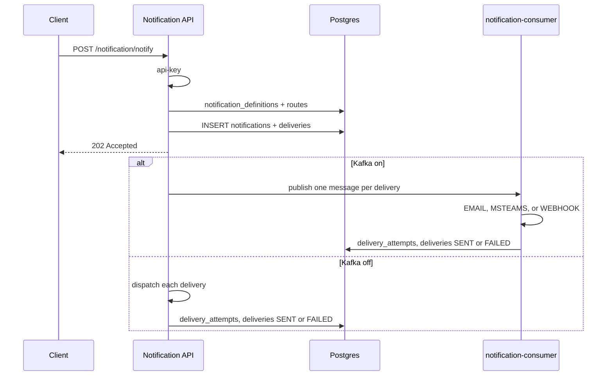

# Data Notification — Request Flow

Catalog và request là hai bảng khác nhau.

| Bảng | Vai trò |
|------|---------|
| `notification_definitions` | Định nghĩa mã (`AIRFLOW_TASK_FAILED`), source, level, trạng thái ACTIVE |
| `notification_routes` | Mỗi mã gửi qua những kênh nào, tới target nào, bằng template nào |
| `notifications` | Một lần caller gọi API. Không lưu trạng thái gửi |
| `deliveries` | Một route của request đó |
| `delivery_attempts` | Từng lần gọi kênh, kể cả retry |



## Request

`POST /notification/notify` với header `api-key`.

```json
{
  "code": "AIRFLOW_TASK_FAILED",
  "trace_id": "airflow-etl-customer-20261011",
  "variables": {
    "dag_id": "etl_customer",
    "error": "Connection timeout"
  }
}
```

`source_code`, kênh, target và template lấy từ `definitions` theo `code`. `trace_id` là `notifications.idempotency_key`.

API render template của definition, rồi ghi `notifications` và `deliveries` trong một transaction. Trả **202 Accepted**. Cùng `(source_code, trace_id)` lần nữa trả **409**.

## Trạng thái delivery

| Kết quả | `deliveries.status` | attempt |
|---------|---------------------|---------|
| Kênh chấp nhận | `SENT` | `SUCCESS` |
| Gửi lỗi | `FAILED` | `FAILED` |

Kafka bật thì API để delivery ở `PENDING` cho đến khi consumer gửi xong. Kafka tắt thì API gửi ngay và ghi kết quả.

`notifications` không có cột status. Xem các delivery của `notification_id` đó.

## Routing và auth

- Public: `GET /health`
- Protected (`api-key`, rồi logging): các route dưới `/notification`

`POST /notification` tạo một dòng `notification_definitions` (`code`, `name`, `source_code`, `level`). Route gửi (channel, target, template) nằm ở `notification_routes`.
