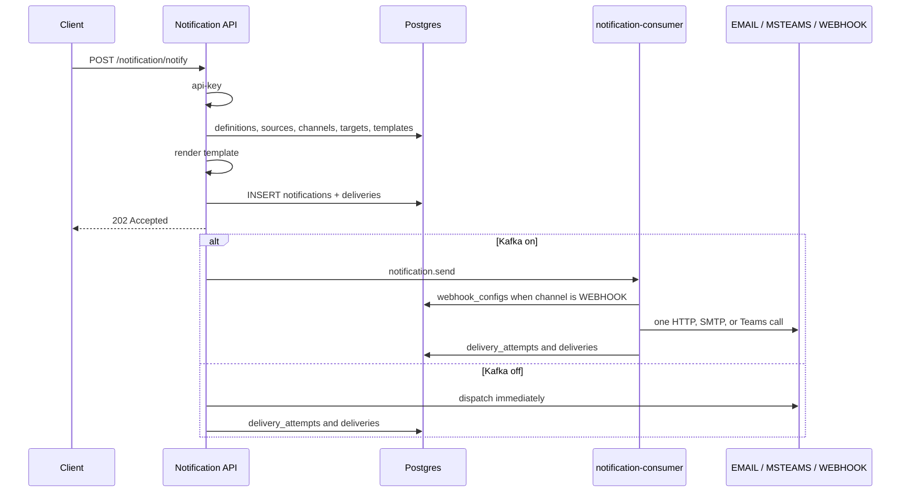

# Data Notification — Request Flow

Caller gửi `code`. Destination nằm trên `definitions`, không nằm trong request.

| Bảng | Vai trò |
|------|---------|
| `sources` | Service được phép phát notification |
| `channels` | Cách vận chuyển: `EMAIL`, `MSTEAMS`, `WEBHOOK` |
| `targets` | Đích nhận, gắn với một `channel_id` |
| `templates` | Title và body, render bằng `{{key}}` |
| `webhook_configs` | Endpoint, method, timeout và `max_retries` của channel `WEBHOOK` |
| `definitions` | Một `code` trỏ tới source, channel, target và template |
| `notifications` | Một lần caller gọi API. Không lưu trạng thái gửi |
| `deliveries` | Bản render của lần gọi đó |
| `delivery_attempts` | Từng lần gọi kênh, kể cả retry |



## Request

`POST /notification/notify` với header `api-key`.

```json
{
  "code": "AIRFLOW_TASK_FAILED",
  "trace_id": "airflow-etl-customer-20261011",
  "variables": {
    "dag_id": "etl_customer",
    "error": "Connection timeout"
  }
}
```

`source`, channel, target và template được lấy từ `definitions` theo `code`. `trace_id` là `notifications.idempotency_key`. Cùng `(source_code, trace_id)` lần nữa trả **409**.

API render template, rồi ghi `notifications` và một `deliveries` trong cùng transaction. Response là **202 Accepted**.

## Webhook

`WebhookService` chỉ thực hiện một lần gửi HTTP:

- Method lấy từ `webhook_configs.method`: `POST`, `PUT`, `PATCH`.
- Timeout lấy từ `webhook_configs.timeout_seconds`.
- Body là JSON payload đã render.
- HTTP 2xx là thành công. HTTP 4xx, 5xx, timeout và lỗi kết nối trả `AppError`.

Worker đọc `max_retries`, ghi mỗi lần gọi vào `delivery_attempts`, rồi cập nhật `deliveries`. Timeout được ghi `TIMEOUT`; lỗi HTTP hoặc kết nối được ghi `FAILED`.

## Trạng thái delivery

| Kết quả | `deliveries.status` | `delivery_attempts.status` |
|---------|---------------------|----------------------------|
| Kênh chấp nhận | `SENT` | `SUCCESS` |
| Còn lượt retry | `RETRY_WAIT` | `FAILED` hoặc `TIMEOUT` |
| Hết lượt retry | `FAILED` | `FAILED` hoặc `TIMEOUT` |

Kafka bật thì delivery ở `PENDING` cho đến khi consumer xử lý. Kafka tắt thì API gửi ngay và ghi kết quả.

`notifications` không có cột status. Trạng thái gửi nằm ở delivery của `notification_id`.

## Routing

- Public: `GET /health`
- Protected bằng `api-key`: các route dưới `/notification`
