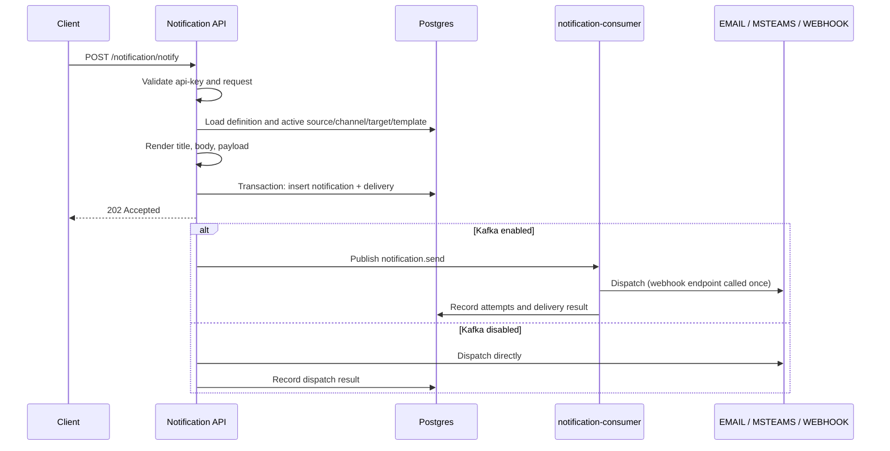

# Notification API flow

`/notification` exposes the send operation only. The caller does not create, list, read, update, or delete notification records through HTTP. A notification and its delivery are written internally when a valid send request is accepted.

## Configuration and runtime data

| Table | Purpose |
|---|---|
| `sources` | Services allowed to send notifications |
| `channels` | Delivery types: `EMAIL`, `MSTEAMS`, `WEBHOOK` |
| `targets` | Reusable destination groups associated with a channel |
| `definition_targets` | Maps each definition to one or more destination groups, each with its template |
| `templates` | Template identity (name, status) referenced by `definition_targets.template_id` |
| `template_versions` | Versioned title, body, and format (`TEXT`/`HTML` for EMAIL, `ADAPTIVE_CARD` for MSTEAMS, `JSON` for WEBHOOK), rendered with `{{key}}`; a send uses the latest `ACTIVE` version |
| `webhook_configs` | Webhook endpoint, method, timeout, and retry configuration; one row per WEBHOOK target |
| `definitions` | Maps a caller `code` to its source, channel, and selected targets |
| `notifications` | Runtime record for an accepted send request |
| `deliveries` | Rendered message and delivery status |
| `delivery_attempts` | Individual dispatch attempts |

The service has no `/notification` CRUD endpoint for `definitions`; definitions are provisioned in the database. Source, target, and template configuration endpoints remain available under `/notification/sources`, `/notification/targets`, and `/notification/templates`.

Each definition links to one or more targets through `definition_targets`. The template is selected by `definition_targets.template_id`; `definitions` has no template column. A WEBHOOK target with a `template_id` takes its request body from the latest `ACTIVE` version of that template, which must have `format = 'JSON'` and a JSON object as `content`. A WEBHOOK target without a `template_id` sends the request's `variables` object unchanged as its body. EMAIL and MSTEAMS require a template and render one title and body from the first target (in `definition_targets.id` order) that has one. Placeholders such as `{{date_key}}` are replaced from the request's `variables`; each target gets its own rendered request body. EMAIL merges recipients from selected targets, while MSTEAMS and WEBHOOK send separately to each selected target.

Webhook requests use the shared `HttpClient` created by `Infrastructure` and injected into `WebhookService`. This keeps webhook and token calls on the application's configured HTTP client and middleware; `WebhookService` does not build a separate `reqwest::Client`. Endpoint timeout settings are applied to each request.

## Send sequence



## Request

`POST /notification/notify` with the `api-key` header:

```json
{
  "code": "AIRFLOW_TASK_FAILED",
  "trace_id": "airflow-etl-customer-20261011",
  "variables": {
    "dag_id": "etl_customer",
    "error": "Connection timeout"
  }
}
```

`code` resolves the preconfigured definition. `trace_id` is the caller's idempotency key. A repeated `(source, trace_id)` is rejected with **409 Conflict**. On acceptance, the API stores the notification and one delivery in the same transaction and returns **202 Accepted**.

Each webhook config must have a `webhook_auth_configs` row; a missing row returns **404 Not Found**. With `auth_mode = STATIC`, the service attaches `header_value` using `header_name` (for example, `x-api-key`). With `auth_mode = TOKEN_ENDPOINT`, it calls `token_url`, reads the token using `token_path`, caches it according to the configured TTL, and attaches it using `header_name` plus `header_prefix`. Secrets and tokens are never included in the body or logs.

Additional static headers belong in `webhook_configs.headers`, for example `{"service": "MIS"}`. They are sent with either authentication mode. If a configured header repeats the auth header name, the auth value takes precedence.

```sql
UPDATE webhook_configs
SET headers = '{"service": "MIS"}'::jsonb
WHERE id = <webhook_config_id>;
```

Configure `STATIC` mode for a key supplied directly by the destination:

```sql
UPDATE webhook_auth_configs
SET auth_mode = 'STATIC',
    header_name = 'x-api-key',
    header_value = '<secret>'
WHERE webhook_config_id = <webhook_config_id>;
```

For `TOKEN_ENDPOINT`, set `auth_mode = 'TOKEN_ENDPOINT'`, provide `token_url`, `token_path`, and the token request fields (`token_method`, `token_body_format`, `request_headers`, `request_body`). `header_name` and `header_prefix` control how the returned token is sent. `expires_in_path` and `default_ttl_seconds` control token caching.

## Delivery status

`notifications` records the accepted request and has no delivery status. Status is stored on `deliveries`; each dispatch attempt is stored in `delivery_attempts`.

| Outcome | `deliveries.status` | Attempt result |
|---|---|---|
| Channel accepted | `SENT` | `SUCCESS` |
| Another retry will run | `RETRY_WAIT` | `FAILED` or `TIMEOUT` |
| Retries exhausted | `FAILED` | `FAILED` or `TIMEOUT` |

Webhook method and timeout come from `webhook_configs`. Each webhook delivery calls its endpoint once; token endpoint mode may make a separate request to obtain an expired or missing token. Kafka enabled means the API publishes for asynchronous dispatch; otherwise the API dispatches directly. Non-webhook Kafka deliveries retain the worker retry behavior.

## Routes

| Method | Path | Purpose |
|---|---|---|
| `GET` | `/health` | Public health check |
| `POST` | `/notification/notify` | Validate, accept, and dispatch a notification |
| `POST` | `/notification/sources` | Create a source |
| `GET` | `/notification/sources/{code}` | Read a source |
| `PATCH` | `/notification/sources/metadata` | Update source metadata |
| `POST` | `/notification/targets` | Create a target |
| `GET` | `/notification/targets/{code}` | Read a target |
| `PATCH` | `/notification/targets/metadata` | Update target metadata |
| `POST` | `/notification/templates` | Create a template version (creates the template on first use of `name`) |

All `/notification` routes require `api-key` authentication. Notification CRUD routes are not provided.
