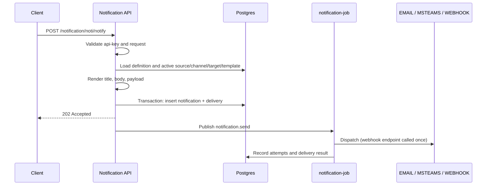

# Notification API flow

`/notification` exposes the send operation only. The caller does not create, list, read, update, or delete notification records through HTTP. A notification and its delivery are written internally when a valid send request is accepted.

## Configuration and runtime data

| Table | Purpose |
|---|---|
| `sources` | Services allowed to send notifications |
| `channels` | Delivery types: `EMAIL`, `MSTEAMS`, `WEBHOOK` |
| `targets` | Reusable destination groups associated with a channel |
| `definition_targets` | Maps each definition to one or more destination groups, each with its template |
| `templates` | Template identity (name, status) referenced by `definition_targets.template_id` |
| `template_versions` | Versioned title, body, and format (`TEXT`/`HTML` for EMAIL, `ADAPTIVE_CARD` for MSTEAMS, `JSON` for WEBHOOK), rendered with `{{key}}`; a send uses the latest `ACTIVE` version |
| `webhook_configs` | Webhook endpoint, method, timeout, and retry configuration; one row per WEBHOOK target |
| `definitions` | Maps a caller `code` to its source, channel, and selected targets |
| `notifications` | Runtime record for an accepted send request |
| `deliveries` | Rendered message and delivery status |
| `delivery_attempts` | Individual dispatch attempts |

Configuration endpoints are available under `/notification/sources`, `/notification/targets`, `/notification/templates`, and `/notification/definitions`.

### Definitions

`POST /notification/definitions` creates a definition and `PUT /notification/definitions/{code}` updates one; both take the same body (the `PUT` takes `code` from the path):

```json
{
  "code": "AIRFLOW_TASK_FAILED",
  "name": "Airflow task failed",
  "description": "Sent when a DAG task fails",
  "status": "ACTIVE",
  "level": "ERROR",
  "source_code": "AIRFLOW",
  "channel_code": "EMAIL",
  "targets": [
    { "target_code": "DATA_TEAM", "template_id": 1 },
    { "target_code": "ONCALL" }
  ]
}
```

`status` (`ACTIVE` / `INACTIVE`) and `level` (`INFO` / `WARN` / `ERROR` / `CRITICAL`) are optional: a create defaults them to `ACTIVE` and `INFO`, an update keeps the stored value. `description` is replaced on update, so omitting it clears it. `targets` must not be empty and is stored in the given order; an update replaces the whole list. Both return the stored definition, with targets as `target_id` / `template_id`.

The request is rejected with **400 Bad Request** when the source, channel, a target, or a template is unknown, a target belongs to another channel, a target is listed twice, a template's format does not fit the channel (`JSON` for WEBHOOK only), or an EMAIL / MSTEAMS definition has no template on any target. A duplicate `code` returns **409 Conflict**.

`GET /notification/definitions` lists all definitions ordered by `code`, `GET /notification/definitions/{code}` returns one, and `DELETE /notification/definitions/{code}` removes the definition and its target links. Notifications already accepted for it are kept.

Each definition links to one or more targets through `definition_targets`. The template is selected by `definition_targets.template_id`; `definitions` has no template column. A WEBHOOK target with a `template_id` takes its request body from the latest `ACTIVE` version of that template, which must have `format = 'JSON'` and a JSON object as `content`. A WEBHOOK target without a `template_id` sends the request's `variables` object unchanged as its body. EMAIL and MSTEAMS require a template and render one title and body from the first target (in `definition_targets.id` order) that has one. Placeholders such as `{{date_key}}` are replaced from the request's `variables`; each target gets its own rendered request body. EMAIL merges recipients from selected targets, while MSTEAMS and WEBHOOK send separately to each selected target.

Webhook requests use the shared `HttpClient` created by `Infrastructure` and injected into `WebhookService`. This keeps webhook and token calls on the application's configured HTTP client and middleware; `WebhookService` does not build a separate `reqwest::Client`. Endpoint timeout settings are applied to each request.

## Send sequence



## Request

`POST /notification/noti/notify` with the `api-key` header:

```json
{
  "code": "AIRFLOW_TASK_FAILED",
  "trace_id": "airflow-etl-customer-20261011",
  "variables": {
    "dag_id": "etl_customer",
    "error": "Connection timeout"
  }
}
```

`code` resolves the preconfigured definition. `trace_id` is the caller's idempotency key. A repeated `(source, trace_id)` is rejected with **409 Conflict**. On acceptance, the API stores the notification and one delivery in the same transaction and returns **202 Accepted**.

Each webhook config must have a `webhook_auth_configs` row; a missing row returns **404 Not Found**. With `auth_mode = STATIC`, the service attaches `header_value` using `header_name` (for example, `x-api-key`). With `auth_mode = TOKEN_ENDPOINT`, it calls `token_url`, reads the token using `token_path`, caches it according to the configured TTL, and attaches it using `header_name` plus `header_prefix`. Secrets and tokens are never included in the body or logs.

Additional static headers belong in `webhook_configs.headers`, for example `{"service": "MIS"}`. They are sent with either authentication mode. If a configured header repeats the auth header name, the auth value takes precedence.

```sql
UPDATE webhook_configs
SET headers = '{"service": "MIS"}'::jsonb
WHERE id = <webhook_config_id>;
```

### Webhook configs API

`POST /notification/webhooks` creates the `webhook_configs` row and its `webhook_auth_configs` row for a WEBHOOK target; `PUT /notification/webhooks/{target_code}` replaces both. The body is the same for both (`PUT` takes `target_code` from the path):

```json
{
  "target_code": "HOOK_DEMO",
  "domain": "https://partner.example.com",
  "path": "/api/notify",
  "method": "POST",
  "timeout_seconds": 10,
  "max_retries": 3,
  "headers": { "service": "MIS" },
  "auth": {
    "auth_mode": "STATIC",
    "header_name": "x-api-key",
    "header_value": "<secret>"
  }
}
```

`method` is `POST` (default), `PUT`, or `PATCH`; `timeout_seconds` defaults to 10 and `max_retries` to 3. For `TOKEN_ENDPOINT`, `auth` takes `token_url` (required), `token_method`, `token_body_format` (`JSON` / `FORM`), `request_headers`, `request_body`, `token_path`, `expires_in_path`, `default_ttl_seconds`, and `header_prefix`, with the same defaults as the table columns. URLs must be `http`/`https` with a host and no credentials, and header names and values are checked before anything is stored.

The response returns the stored config without secrets: `header_value`, `request_headers`, and `request_body` are never returned, and `auth.has_header_value` shows whether a static value is set. Updating a config drops its cached token. A target that is unknown or not on the WEBHOOK channel returns **400**, a second config for the same target **409**, and an unknown `target_code` on read, update, or delete **404**.

The same settings can also be written directly in SQL. Configure `STATIC` mode for a key supplied directly by the destination:

```sql
UPDATE webhook_auth_configs
SET auth_mode = 'STATIC',
    header_name = 'x-api-key',
    header_value = '<secret>'
WHERE webhook_config_id = <webhook_config_id>;
```

For `TOKEN_ENDPOINT`, set `auth_mode = 'TOKEN_ENDPOINT'`, provide `token_url`, `token_path`, and the token request fields (`token_method`, `token_body_format`, `request_headers`, `request_body`). `header_name` and `header_prefix` control how the returned token is sent. `expires_in_path` and `default_ttl_seconds` control token caching.

## gRPC (internal)

`data-notification` also serves every API route over gRPC for internal callers, on `server.grpc.port` (default config: `50051`) when `server.grpc.enabled` is `true`. The contract is [`proto/notification.proto`](../proto/notification.proto). Each RPC runs the same normalization, validation, and service call as its HTTP route.

| HTTP route | gRPC method |
|---|---|
| `POST /noti/notify` | `notification.v1.Notification/Notify` |
| `GET /sources` | `notification.v1.Sources/ListSources` |
| `GET /sources/{code}` | `notification.v1.Sources/GetSource` |
| `POST /sources` | `notification.v1.Sources/CreateSource` |
| `PATCH /sources/metadata` | `notification.v1.Sources/PatchSourceMetadata` |
| `GET /targets` | `notification.v1.Targets/ListTargets` |
| `GET /targets/{code}` | `notification.v1.Targets/GetTarget` |
| `POST /targets` | `notification.v1.Targets/CreateTarget` |
| `PATCH /targets/metadata` | `notification.v1.Targets/PatchTargetMetadata` |
| `POST /templates` | `notification.v1.Templates/SaveTemplate` |
| `GET /definitions` | `notification.v1.Definitions/ListDefinitions` |
| `GET /definitions/{code}` | `notification.v1.Definitions/GetDefinition` |
| `POST /definitions` | `notification.v1.Definitions/CreateDefinition` |
| `PUT /definitions/{code}` | `notification.v1.Definitions/UpdateDefinition` (`code` in the message) |
| `DELETE /definitions/{code}` | `notification.v1.Definitions/DeleteDefinition` |
| `GET /webhooks` | `notification.v1.Webhooks/ListWebhooks` |
| `GET /webhooks/{target_code}` | `notification.v1.Webhooks/GetWebhook` (`CodeRequest.code` is the target code) |
| `POST /webhooks` | `notification.v1.Webhooks/CreateWebhook` |
| `PUT /webhooks/{target_code}` | `notification.v1.Webhooks/UpdateWebhook` (`target_code` in the message) |
| `DELETE /webhooks/{target_code}` | `notification.v1.Webhooks/DeleteWebhook` |

JSON objects (`variables`, `metadata`, `headers`, `request_headers`, `request_body`) are `google.protobuf.Struct`, timestamps are `google.protobuf.Timestamp`, and enum-like values stay strings. Webhook fields with an HTTP default are `optional` in the proto and take the same default when omitted; send `expires_in_path: ""` to clear it.

| | HTTP | gRPC |
|---|---|---|
| Auth | header `api-key` | metadata `api-key` |
| `variables` | JSON object | `google.protobuf.Struct` |
| Success | `200` / `201` / `202` | `OK` (`Notify` echoes `trace_id`; empty replies are `google.protobuf.Empty`) |
| Bad request / invalid configuration | `400` | `INVALID_ARGUMENT` |
| Unknown source, code, target, or webhook | `404` | `NOT_FOUND` |
| Conflict, e.g. repeated `(source, trace_id)` | `409` | `ALREADY_EXISTS` |
| Missing or wrong key | `401` | `UNAUTHENTICATED` |
| Internal failure (including Kafka not connected) | `500` | `INTERNAL` |

`Struct` carries every number as a double. Whole numbers are converted back to integers, so `20261011` renders as `20261011` in a template, not `20261011.0`; integers beyond 2^53 lose precision and should be sent as strings.

The server is plaintext (no TLS) and does not expose gRPC reflection, so callers need the `.proto` file:

```bash
grpcurl -plaintext -import-path proto -proto notification.proto \
  -H 'api-key: <key>' \
  -d '{"source":"AIRFLOW","code":"AIRFLOW_TASK_FAILED","trace_id":"airflow-etl-customer-20261011","variables":{"dag_id":"etl_customer"}}' \
  localhost:50051 notification.v1.Notification/Notify
```

## Delivery status

`notifications` records the accepted request and has no delivery status. Status is stored on `deliveries`; each dispatch attempt is stored in `delivery_attempts`.

| Outcome | `deliveries.status` | Attempt result |
|---|---|---|
| Channel accepted | `SENT` | `SUCCESS` |
| Another retry will run | `RETRY_WAIT` | `FAILED` or `TIMEOUT` |
| Retries exhausted | `FAILED` | `FAILED` or `TIMEOUT` |

Webhook method and timeout come from `webhook_configs`. Each webhook delivery calls its endpoint once; token endpoint mode may make a separate request to obtain an expired or missing token. The API only publishes to Kafka and never calls a channel itself; `notification-job` consumes the topic and dispatches. If Kafka is not connected the send request fails before anything is recorded. Non-webhook deliveries retain the worker retry behavior.

## Routes

| Method | Path | Purpose |
|---|---|---|
| `GET` | `/health` | Public health check |
| `POST` | `/notification/noti/notify` | Validate, accept, and dispatch a notification |
| `GET` | `/notification/sources` | List sources |
| `POST` | `/notification/sources` | Create a source |
| `GET` | `/notification/sources/{code}` | Read a source |
| `PATCH` | `/notification/sources/metadata` | Update source metadata |
| `GET` | `/notification/targets` | List targets |
| `POST` | `/notification/targets` | Create a target |
| `GET` | `/notification/targets/{code}` | Read a target |
| `PATCH` | `/notification/targets/metadata` | Update target metadata |
| `POST` | `/notification/templates` | Create a template version (creates the template on first use of `name`) |
| `GET` | `/notification/definitions` | List definitions |
| `POST` | `/notification/definitions` | Create a definition |
| `GET` | `/notification/definitions/{code}` | Read a definition |
| `PUT` | `/notification/definitions/{code}` | Update a definition and replace its targets |
| `DELETE` | `/notification/definitions/{code}` | Delete a definition |
| `GET` | `/notification/webhooks` | List webhook configs |
| `POST` | `/notification/webhooks` | Create the webhook config and auth config of a WEBHOOK target |
| `GET` | `/notification/webhooks/{target_code}` | Read a webhook config |
| `PUT` | `/notification/webhooks/{target_code}` | Replace a webhook config and its auth config |
| `DELETE` | `/notification/webhooks/{target_code}` | Delete a webhook config and its auth config |

Every list route (`GET /sources`, `/targets`, `/definitions`, `/webhooks`) is paged with `?page=&size=` (`PageRequest`, `src/models/page.rs`): `page` and `size` are unsigned (`u32`); missing or `0` takes the default (page 1, size 10), and `size` above 100 is `400`. Rows are ordered by `code`, and `data` is a `PageData`, where `total` is the row count before paging:

```json
{ "items": [ ... ], "total": 42 }
```

The matching gRPC `List*` RPCs take a `PageRequest` message (`uint32 page`, `uint32 size`, same defaults and limits) and return `items` and `total`.

All `/notification` routes require `api-key` authentication. Notification CRUD routes are not provided.
