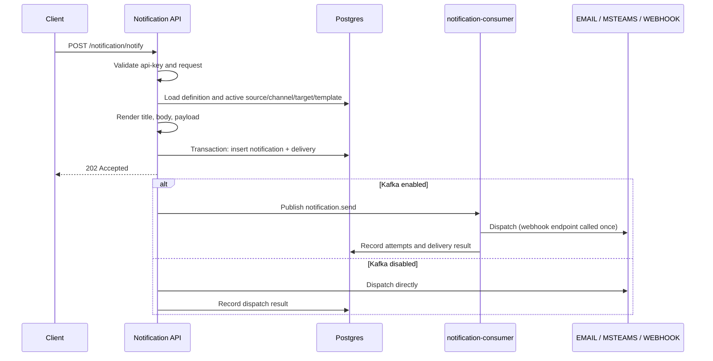

# Notification API flow

`/notification` exposes the send operation only. The caller does not create, list, read, update, or delete notification records through HTTP. A notification and its delivery are written internally when a valid send request is accepted.

## Configuration and runtime data

| Table | Purpose |
|---|---|
| `sources` | Services allowed to send notifications |
| `channels` | Delivery types: `EMAIL`, `MSTEAMS`, `WEBHOOK` |
| `targets` | Destination data associated with a channel |
| `templates` | Message title and body, rendered with `{{key}}` |
| `webhook_configs` | Webhook endpoint, method, timeout, and retry configuration |
| `definitions` | Maps a caller `code` to its source, channel, target, and template |
| `notifications` | Runtime record for an accepted send request |
| `deliveries` | Rendered message and delivery status |
| `delivery_attempts` | Individual dispatch attempts |

The service has no `/notification` CRUD endpoint for `definitions`; definitions are provisioned in the database. Source, target, and template configuration endpoints remain available under `/notification/sources`, `/notification/targets`, and `/notification/templates`.

## Send sequence



## Request

`POST /notification/notify` with the `api-key` header:

```json
{
  "code": "AIRFLOW_TASK_FAILED",
  "trace_id": "airflow-etl-customer-20261011",
  "variables": {
    "dag_id": "etl_customer",
    "error": "Connection timeout"
  }
}
```

`code` resolves the preconfigured definition. `trace_id` is the caller's idempotency key. A repeated `(source, trace_id)` is rejected with **409 Conflict**. On acceptance, the API stores the notification and one delivery in the same transaction and returns **202 Accepted**.

`webhook_auth_configs.request_headers` configures headers for the token request. The configured token header (`header_name` and `header_prefix`) is attached to the outgoing webhook request.

## Delivery status

`notifications` records the accepted request and has no delivery status. Status is stored on `deliveries`; each dispatch attempt is stored in `delivery_attempts`.

| Outcome | `deliveries.status` | Attempt result |
|---|---|---|
| Channel accepted | `SENT` | `SUCCESS` |
| Another retry will run | `RETRY_WAIT` | `FAILED` or `TIMEOUT` |
| Retries exhausted | `FAILED` | `FAILED` or `TIMEOUT` |

Webhook method and timeout come from `webhook_configs`. Each webhook delivery calls its endpoint once; when auth is configured, the service obtains the token and sends it in the configured header. Kafka enabled means the API publishes for asynchronous dispatch; otherwise the API dispatches directly. Non-webhook Kafka deliveries retain the worker retry behavior.

## Routes

| Method | Path | Purpose |
|---|---|---|
| `GET` | `/health` | Public health check |
| `POST` | `/notification/notify` | Validate, accept, and dispatch a notification |
| `POST` | `/notification/sources` | Create a source |
| `GET` | `/notification/sources/{code}` | Read a source |
| `PATCH` | `/notification/sources/metadata` | Update source metadata |
| `POST` | `/notification/targets` | Create a target |
| `GET` | `/notification/targets/{code}` | Read a target |
| `PATCH` | `/notification/targets/metadata` | Update target metadata |
| `POST` | `/notification/templates` | Create a template version |

All `/notification` routes require `api-key` authentication. Notification CRUD routes are not provided.
